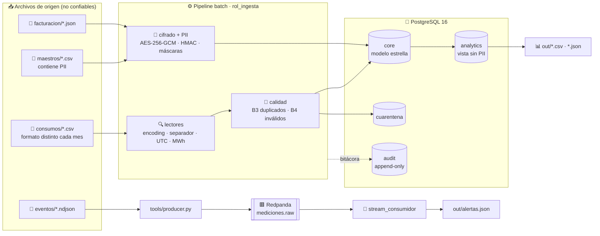
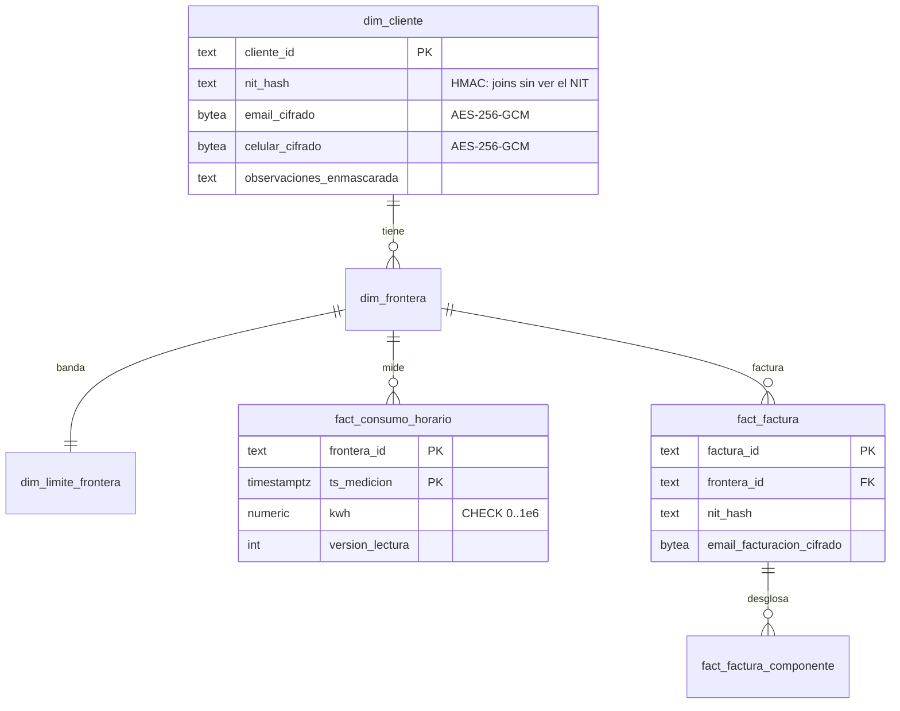
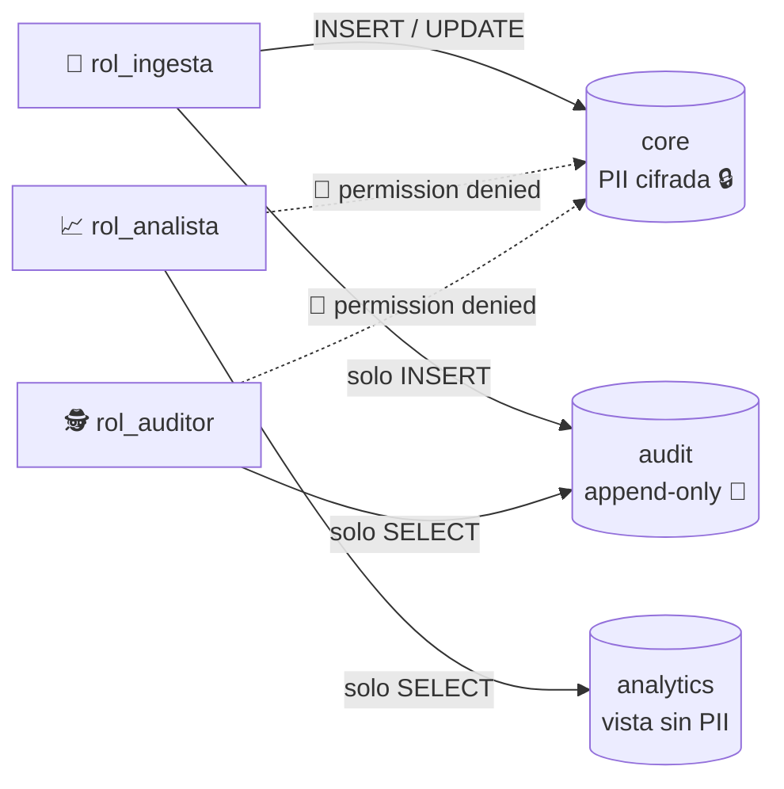

<div align="center">

# ⚡ Plataforma de datos de consumo energético

**Ingesta idempotente · Calidad de datos exacta · PII cifrada · Alertas en streaming**

[](https://www.python.org/)
[](https://www.postgresql.org/)
[](https://redpanda.com/)
[](https://docs.docker.com/compose/)
<br>
[](https://www.terraform.io/)
[](https://aws.amazon.com/)
[](tests/)
[](SECURITY.md)

[🚀 Cómo correrlo](#-1-cómo-correrlo) ·
[🏗️ Arquitectura](#️-2-arquitectura) ·
[📐 Reglas](#-3-reglas-que-implementa) ·
[🔐 Seguridad](#-c--seguridad-privacidad-y-gobernanza) ·
[☁️ Despliegue](#️-4-endurecimientos-para-el-despliegue-en-aws)

</div>

---

Plataforma de datos para los **consumos horarios de fronteras comerciales de energía** en Colombia.
Recibe archivos crudos que llegan en un formato distinto cada mes y hace cuatro cosas:

- 🧹 Los **limpia** con reglas de calidad exactas.
- 🔁 Los **carga de forma idempotente** en PostgreSQL.
- 🔐 **Protege los datos personales** con cifrado en la aplicación, roles de menor privilegio y una bitácora append-only.
- 📡 **Vigila las mediciones en vivo** con un consumidor de Kafka (Redpanda) que emite alertas.

> [!TIP]
> **✅ Lista para producción.** Tiene transacciones por archivo, cuarentena consultable, logs
> estructurados sin PII, un threat model STRIDE mapeado a ISO/IEC 27001:2022 e infraestructura AWS
> en Terraform (S3, KMS, IAM). Corre completa en local con Docker y `make`. Para desplegarla en AWS
> se aplican `infra/` y los endurecimientos de la [§4](#️-4-endurecimientos-para-el-despliegue-en-aws).

<div align="center">

| 📥 Filas procesadas | ✅ Cargadas | 🚧 En cuarentena | 🔐 Clientes con PII protegida | 🚨 Alertas |
|:---:|:---:|:---:|:---:|:---:|
| **115.340** | **114.545** | **495** | **40 / 40** | **33** |

</div>

---

## 🚀 1. Cómo correrlo

**Requisitos:** Linux (o WSL2), Docker con Compose v2, `make`, Python 3.10 o superior con `venv`.
Terraform solo para `make validar-infra` (opcional).

```bash
make setup      # 📦 .venv + dependencias; crea .env y genera las llaves de cifrado
make up         # 🐘 Postgres + Redpanda (solo en 127.0.0.1), espera los healthchecks y aplica sql/*.sql
make run        # ⚙️  pipeline batch completo                      (~7 s desde cero)
make run        # 🔁 otra vez: salta todo por hash, mismo estado  (~1 s)
make stream     # 📡 tópico nuevo + productor + consumidor        (~11 s, termina solo)
make test       # 🧪 72 pruebas
make down       # 🛑 apaga la infraestructura

make validar-infra  # ☁️  terraform init -backend=false + validate + fmt -check
make clean          # 🧽 down -v + borra out/ y logs/
```

> [!NOTE]
> **📁 Datos:** `data/` no está en el repositorio porque contiene datos personales. El pipeline
> espera `data/consumos/*.csv`, `data/maestros/{clientes,fronteras,limites_frontera}.csv`,
> `data/facturacion/*.json` y `data/eventos/mediciones_stream.ndjson`.

### 📤 Salidas

| Archivo | Comando | Contenido |
|---|---|---|
| 📊 `out/consumo_mensual.csv` | `make run` | `frontera_id,mes,consumo_kwh,horas_con_dato`, kWh con 3 decimales |
| 🩺 `out/dq_report.json` | `make run` | Conteos de calidad (ver [§3](#-b--calidad-de-datos)) |
| ⏱️ `out/metrics.json` | `make run` | Filas leídas, cargadas y rechazadas por motivo, duración por etapa |
| 📜 `logs/pipeline.log` | `make run` / `make stream` | Una línea JSON por evento, sin PII |
| 🚨 `out/alertas.json` | `make stream` | Alertas sin duplicados, `ts` ISO 8601 con offset |

---

## 🏗️ 2. Arquitectura



### 🧩 Piezas

| Pieza | Archivo |
|---|---|
| 🔍 Lectura con detección de encoding, separador, columnas, zona horaria y unidad | `src/lectores.py` |
| 🧹 Reglas B3/B4 como funciones puras | `src/calidad.py` |
| 🎼 Orquestación, transacción por archivo, salto por hash, bitácora | `src/pipeline.py` |
| 👥 Maestros (PII cifrada) y facturación (B6) | `src/maestros.py`, `src/facturacion.py` |
| 🔐 Cifrado AES-256-GCM, HMAC del NIT, enmascarado de PII | `src/cifrado.py`, `src/pii.py` |
| 🏷️ Clasificación viva | `data_classification.yaml`, `src/clasificacion.py` |
| 📤 Salidas y logs JSON | `src/salidas.py`, `src/logs.py` |
| 🚨 Alertas en streaming | `src/alertas.py`, `src/stream_consumidor.py` |
| 🗄️ Modelo, roles, bitácora | `sql/01..05_*.sql` |
| ☁️ Infraestructura en AWS | `infra/*.tf` |
| 🔬 Exploración inicial de los datos | `scripts/exploracion.py` |
| 🧬 Huella para comprobar idempotencia | `scripts/huella.sql` |

### ⭐ Modelo de datos (estrella, ADR-003)



Además: 🚧 `cuarentena.*` (un esquema por tipo de rechazo, sin PII), 🎛️ `control.archivo_procesado`
(hash SHA-256 y conteos por archivo), 📜 `audit.bitacora_corridas` y 📊 `analytics.v_consumo_mensual`.

---

## 📐 3. Reglas que implementa

> [!NOTE]
> En el código, las etiquetas **`[README B3]`**, **`[README C4]`**, etc. apuntan a esta sección.
> Las otras etiquetas son `[Exploración]` (salió de analizar los datos reales) y `[Prevención]`
> (evita una falla concreta que los datos todavía no traen).

### 📥 A · Ingesta e idempotencia
- 📂 **Descubrimiento:** se procesa **lo que haya** en `data/consumos/` (orden lexicográfico), no
  una lista fija de meses. El formato (encoding, separador, nombre de columnas, zona horaria,
  unidad) se **detecta** en cada archivo.
- 🔁 **Idempotencia:** dos `make run` seguidos dejan exactamente el mismo estado (huella SHA-256
  por archivo + upsert por `(frontera_id, ts_medicion)`).
- ⏰ **Datos tardíos:** un archivo de corrección reemplaza lecturas ya cargadas sin recargar todo.
- 🚧 **Cuarentena:** lo rechazado no se borra; queda consultable con su motivo.
- 🛡️ **Robustez:** un archivo truncado o corrupto se rechaza entero; los meses ya cargados no cambian.

### 🧹 B · Calidad de datos
| # | Regla |
|:---:|---|
| 🕐 **B1** | Mes y hora en hora local de Colombia (`America/Bogota`, UTC−5 fijo). Los archivos en UTC se normalizan. |
| ⚖️ **B2** | El resultado siempre en **kWh**; MWh se convierte (× 1000, con `Decimal`). |
| 👯 **B3** | Para una misma `(frontera_id, timestamp)` gana la mayor `version_lectura`; si empatan, la última en orden de archivo (nombre lexicográfico) y de fila. |
| 🚫 **B4** | Se descartan y reportan: valor nulo, negativo o `> 1.000.000 kWh`. Se aplica **antes** de B3 (ADR-004). |
| 🕳️ **B5** | Una hora sin lectura válida es un hueco: se reporta, no se rellena. |
| 👻 **B6** | Una factura cuya frontera no existe en el maestro va a cuarentena. |
| 🦠 **B7** | Las entradas hostiles del maestro son datos, no código: comillas anidadas, saltos de línea en un campo, cadenas enormes, texto con SQL. Ninguna fila se pierde en silencio. |

<details>
<summary><b>🩺 Resultado sobre el conjunto de datos de referencia (<code>out/dq_report.json</code>)</b></summary>

| Llave | Valor |
|---|---:|
| `filas_leidas` | 115.340 |
| `duplicados_exactos` / `duplicados_conflictivos` | 180 / 120 |
| `registros_negativos` / `registros_nulos` / `registros_outlier` | 90 / 60 / 45 |
| `registros_mwh_convertidos` | 400 |
| `correcciones_tardias_aplicadas` | 300 |
| `horas_sin_lectura_valida_total` | 655 |
| `fronteras_huerfanas_facturacion` | 12 |
| `clientes_con_pii_en_texto_libre` | 25 |

</details>

### 🔐 C · Seguridad, privacidad y gobernanza

> [!IMPORTANT]
> Marco: **Ley 1581 de 2012** (protección de datos personales) e **ISO/IEC 27001:2022**.
> Detalle y comandos de verificación en [`SECURITY.md`](SECURITY.md).

| # | Control |
|:---:|---|
| 🏷️ **C1** | `data_classification.yaml` etiqueta cada columna (`Público` / `Interno` / `Confidencial` / `Restringido-PII`); el pipeline lo lee para decidir qué cifrar y una prueba exige que esté completo. |
| 🎭 **C2** | Los correos, celulares y cédulas escritos en texto libre (`observaciones`) se detectan y enmascaran. |
| 🔒 **C3** | PII cifrada con **AES-256-GCM en la aplicación**: la llave nunca llega a la base. El HMAC del NIT permite cruzar facturas y clientes sin exponerlo. |
| 👮 **C4** | Tres roles de menor privilegio: `rol_ingesta` (escribe, no lee PII en claro), `rol_analista` (solo la vista analítica), `rol_auditor` (solo la bitácora). El pipeline no usa el superusuario. |
| 📜 **C5** | Bitácora **append-only**: `UPDATE`/`DELETE`/`TRUNCATE` revocados + triggers que los bloquean incluso al superusuario. |
| 🗝️ **C6** | Cero credenciales en el código: todo en `.env`, fuera de git. |
| 📦 **C7** | Dependencias auditadas con `pip-audit` (de 47 vulnerabilidades en el prototipo inicial a 0) y fijadas con `==`. |
| 🎯 **C8** | [`THREAT_MODEL.md`](THREAT_MODEL.md): 12 amenazas STRIDE sobre esta arquitectura, cada una con su control y su mapeo al Anexo A de ISO 27001. |



### 📡 D · Streaming
Consumidor del tópico `mediciones.raw` sobre una rejilla de 96 intervalos de 15 minutos:

| Alerta | Condición |
|---|---|
| 🔇 `FRONTERA_SIN_REPORTE` | 3 intervalos consecutivos sin medición (una alerta por caída; `ts` del tercer intervalo). |
| 📈 `CONSUMO_FUERA_DE_BANDA` | `kwh` estrictamente mayor que el `max_kwh` de la frontera. |
| ⏪ `LECTURA_RETROACTIVA` | Llega una medición anterior a la última ya procesada de esa frontera. |

### 🔭 E · Observabilidad
📜 Logs JSON (una línea por evento) con filtro anti-PII · ⏱️ `out/metrics.json` · 🗂️ bitácora por
etapa · 🧯 [`RUNBOOK.md`](RUNBOOK.md) para responder a fallas.

### ☁️ F · Infraestructura como código
`infra/` describe la infraestructura en AWS:
- 🪣 S3 con SSE-KMS, versionado, bloqueo de acceso público y solo HTTPS.
- 🔑 KMS con rotación y política de llave.
- 👮 Roles IAM equivalentes a C4.

`terraform validate` pasa sin errores ✅.

---

## ☁️ 4. Endurecimientos para el despliegue en AWS

> [!WARNING]
> En local se toman algunos atajos a propósito. Al desplegar en AWS, cada uno se reemplaza así:

| Hoy en local | En el despliegue |
|---|---|
| 🟥 Kafka sin TLS ni SASL (solo `127.0.0.1`) | TLS + SASL/SCRAM + ACL por tópico |
| 📜 Bitácora sin copia inmutable externa | Réplica en S3 Object Lock o CloudTrail |
| 🗝️ Llaves en `.env` (generadas al azar, fuera de git) | AWS KMS con envelope encryption (`infra/kms.tf`) |
| 🔇 `FRONTERA_SIN_REPORTE` al terminar de consumir | Ventanas de 15 minutos en tiempo real |
| ☁️ Terraform con S3, KMS e IAM | + VPC, RDS y CloudTrail |

📚 Las decisiones de diseño y sus trade-offs están en [`DECISIONS.md`](DECISIONS.md): ADRs, tabla
de ambigüedades y hallazgos de la exploración de datos.

---

<div align="center">

**👤 Anderson Sarmiento**

<sub>Desarrollado con apoyo de Claude Code; cada decisión de diseño fue revisada y verificada contra los datos.</sub>

</div>
